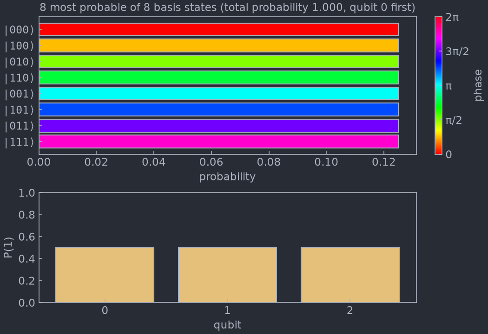

# Visualization

`qleo.visualization` draws a state vector, and can keep a window open that
follows a state while you evolve it:

- [`plotstate`](#plotting-a-state-plotstate) returns a matplotlib figure of a
  state at one moment.
- [`StateWindow`](#watching-a-state-evolve-statewindow) is a window that moves
  gradually to the new state each time you call `update()`.

Both read the state in place and never copy it (see
[Memory and speed](#memory-and-speed)).

## Installation

The plots need matplotlib, which the base install leaves out. The
`visualization` extra adds it:

```bash
pip install 'qleo[visualization]'
```

The extra installs `mimiqcircuits[visualization]`, so the plots use the same
matplotlib version range and the same MIMIQ style as
`mimiqcircuits.visualization.plothistogram`. `import qleo` alone never loads
matplotlib; the module is imported only when you ask for it:

```python
from qleo.visualization import plotstate, StateWindow
```

A [`StateWindow`](#watching-a-state-evolve-statewindow) also needs a GUI
toolkit for matplotlib to draw into; see [Windows and backends](#windows-and-backends).
`plotstate` does not.

## Plotting a state: `plotstate`

```python
import mimiqcircuits as mc
from qleo import QleoState, evolve
from qleo.visualization import plotstate

# H on every qubit gives all 8 basis states the same probability, 1/8.
# T, S and Z then add a phase of π/4, π/2 and π for each qubit set to 1,
# so basis state i (qubit 0 as the lowest bit) ends up with phase i·π/4.
c = mc.Circuit()
for q in range(3):
    c.push(mc.GateH(), q)
c.push(mc.GateT(), 0)
c.push(mc.GateS(), 1)
c.push(mc.GateZ(), 2)

state, _ = evolve(QleoState.zero(3), c)
fig = plotstate(state)
fig.savefig("phases.png")
```



### Reading the plot

**Top panel: the most probable basis states.** One bar per basis state, most
probable first.

- The bar length is the probability `|⟨i|ψ⟩|²`.
- The bar colour is the phase of the amplitude, read on the colour bar on the
  right. Phase is cyclic, so the colour map is too: a phase just below 2π and
  a phase just above 0 get nearly the same colour. Two states with the same
  probability and different phases, as above, are told apart only by colour.
- States of equal probability come in basis order.
- The title gives how many states are listed and the total probability they
  carry. When that total is well below 1, the state is spread over more basis
  states than the plot lists.

**Bottom panel: `P(1)` for each qubit.** The probability of measuring 1 on
each qubit on its own. It stays readable when `2**n` is far too many
amplitudes to list: a qubit at 0 or 1 is in a definite state, a qubit near 0.5
is maximally uncertain.

**Bitstrings list qubit 0 first**, as `mimiqcircuits.BitString` does: `|100⟩`
is qubit 0 set, the others clear. That is the basis state of index 1, since
qubit 0 is the lowest bit of the index.

### Options

| Argument | Default | Effect |
|---|---|---|
| `num_states` | `15` | Maximum number of basis states listed. |
| `mimiqstyle` | `True` | Draw in the MIMIQ matplotlib style; `False` keeps your active style. |

### In notebooks and scripts

`plotstate` returns a `matplotlib.figure.Figure`.

- **In a notebook**, a call on the last line of a cell displays the figure
  once. Assigned to a variable (`fig = plotstate(state)`), it displays
  nothing until you show `fig`.
- **In a script**, save it with `fig.savefig(...)`, or open it with
  `matplotlib.pyplot.show()`.

## Watching a state evolve: `StateWindow`

`StateWindow` opens a window on a state and redraws it only when you call
`update()`. Each update reads the state as it is then, and moves the picture
there gradually over about a second. Between two updates you evolve the state
by as many gates as you like, so you choose when to look.

```python
import matplotlib.pyplot as plt
import mimiqcircuits as mc
from qleo import QleoState, evolve
from qleo.visualization import StateWindow

state = QleoState.zero(4)
window = StateWindow(state)          # opens on |0000>

# One layer: an RY on every qubit, then a CX ladder.
layer = mc.Circuit()
for q in range(4):
    layer.push(mc.GateRY(0.4), q)
for q in range(3):
    layer.push(mc.GateCX(), q, q + 1)

for _ in range(5):
    evolve(state, layer)             # evolve in place, any number of gates...
    window.update()                  # ...then animate to where the state is now

plt.show()                           # keep the window open at the end
```

The window keeps a reference to `state` and reads it at every `update()`, so
evolve that same object in place, as `evolve` does. It never modifies the
state.

### What an update animates

The window shows what `plotstate` shows. During an update:

- bars grow or shrink to their new probability and slide to their new rank;
- bar colours turn to the new phase, the short way round the colour wheel;
- basis states that leave the list fade out where they stand, and those that
  join it fade in at their new rank;
- the `P(1)` bars and the probability axis move to their new values.

The animation follows the clock: if the window redraws slowly it shows fewer
frames, but still takes the time asked for.

### `update()`

```python
window.update()                      # animate over the window's duration
window.update(duration=0.3)          # a quicker transition
window.update(duration=0)            # jump straight to the new picture
```

`update()` always reads the state the window was created on. To watch
another state, open another window.

| Argument | Default | Effect |
|---|---|---|
| `duration` | the window's | Length of the animation in seconds; `0` jumps straight to the new picture. |

`StateWindow(state, num_states=15, mimiqstyle=True, duration=1.0)` takes the
same `num_states` and `mimiqstyle` as `plotstate`, and `duration` sets the
default length of an update.

`update()` raises `RuntimeError` once the window has been closed; open a new
`StateWindow` to continue.

### Windows and backends

A window needs an interactive matplotlib backend, which in turn needs a GUI
toolkit installed. The toolkit belongs to your environment, so the
`visualization` extra does not install one:

- **Tk** comes with most Python installs (python.org, Windows, conda, most
  Linux distributions), and matplotlib uses it with no setup.
- **Qt** works with `pip install PyQt6` or `pip install PySide6`. Use it where
  Python was built without Tk, as Homebrew's is.

Where the window is drawn from matters:

- **In a script**, the window repaints only while `update()` runs. Between two
  updates it shows the last frame but does not respond to resizing. End the
  script with `plt.show()` to keep the window open and responsive, or pause
  with `plt.pause(seconds)` between updates.
- **In Jupyter**, run `%matplotlib qt` (or `%matplotlib tk`) before creating
  the window. The notebook's default inline backend draws static images, which
  cannot animate.
- **With a non-interactive backend** (`Agg`, inline), nothing opens and
  `update()` redraws the figure in one step. Nothing fails, so the same code
  runs in tests and on headless machines.

## Memory and speed

Neither `plotstate` nor `StateWindow.update()` copies the state vector. Both
read it through `QleoSV.summary(k)`, one parallel pass that collects the
`k` most probable basis states and `P(1)` of every qubit together.

The extra memory is proportional to `num_states`, not to `2**n`, and a plot
costs about as much as reading the state once: 0.25 s on a 28-qubit state
(4 GiB). A `StateWindow` makes that pass at every `update()`, and none in
between.

The same call gives you the numbers without plotting anything:

```python
# The 5 most probable basis states (most probable first), P(1) of every
# qubit, and the squared norm, all from one pass over the state.
indices, amplitudes, p1, norm2 = state.q.summary(5)
```

## Limits

- **Dynamic qubits.** A state built with `dynamic_qubits=True` is refused with
  `ValueError`: its buffer is stored in a permuted qubit order, so bitstring
  labels would name the wrong qubits.
- **GPU state vectors.** Only CPU states can be plotted for now: a state on
  an `QleoSVGpu` is refused with `TypeError`.
